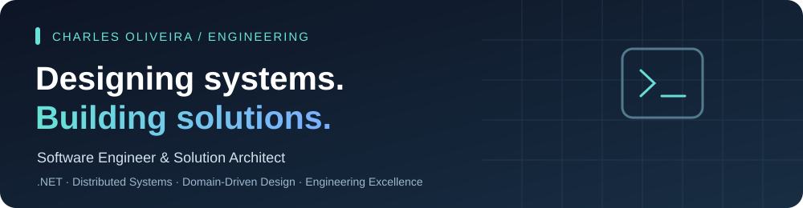

### Software Engineer & Solution Architect

**Designing maintainable systems, building useful products, and learning in public.**

[Portfolio](https://chasoliveira.dev) · [LinkedIn](https://www.linkedin.com/in/chasoliveira/) · [Email](mailto:chasoliveira@outlook.com)

## About me

I'm Charles Oliveira, a Brazilian software engineer and solution architect with **over a decade of experience** building backend services, web applications, integrations, and distributed systems.

My core expertise is in **C# / .NET**, software architecture, domain modeling, and production engineering. I work across the stack with **React and TypeScript**, and use tools such as PostgreSQL, Docker, and automated CI/CD to deliver reliable software.

I believe good engineering goes beyond shipping features: systems should remain **understandable, testable, observable, and adaptable** as requirements change. I enjoy turning complex business problems into explicit domain models and helping other engineers grow.

## Engineering expertise

| Area | What I work on |
| --- | --- |
| **Software architecture** | Clean Architecture, domain-driven design, SOLID, modular boundaries, CQRS, architectural decision records |
| **Backend & APIs** | C#, .NET, REST APIs, asynchronous messaging, integrations, PostgreSQL |
| **Distributed systems** | Microservices, RabbitMQ, gRPC, fault tolerance, service communication |
| **Frontend** | React, TypeScript, Angular, component design and frontend architecture |
| **Engineering excellence** | Unit and integration testing, automated delivery, code reviews, observability |
| **Cloud & tooling** | Docker, Kubernetes, GitHub Actions, Linux and developer environments |

## Featured work

Real applications and experiments are more informative than a list of technologies. The following examples reflect different parts of my engineering work.

### [Khabit Finance in Rust](https://github.com/chasoliveira/khabit-finance) · Learning in public

A personal and family finance backend that I'm building from scratch to learn **Rust through real domain problems**, rather than isolated exercises.

- **Domain challenges:** account balances, valid financial transitions, transfers and increasingly complex financial workflows.
- **Engineering focus:** strong types, ownership, borrowing, error handling, repository boundaries and automated tests.
- **Learning approach:** I write the production code myself and use AI as a mentor for explanations, reviews and architectural discussion.

**Stack:** Rust · Domain Modeling · Automated Testing

### Civon · Enterprise application architecture

A legal operations platform for managing cases, documents and operational workflows. The project is developed in a **private repository**, so its source code is not publicly available.

- **Engineering challenges:** multi-tenant boundaries, intricate domain workflows and transactional consistency.
- **Architecture:** modular .NET backend, application ports and infrastructure adapters, PostgreSQL, and React frontend.
- **Emphasis:** maintainability, automated regression coverage, clear ownership of domain rules and operational reliability.

**Stack:** C# / .NET · React · PostgreSQL · Domain-Driven Design

### Engineering Chronicles · Knowledge sharing

An ongoing initiative to explain software engineering concepts through practical, narrative-driven examples, from fundamentals through architecture and modern AI-assisted development.

**Focus:** Engineering education · System design · .NET · Technical storytelling

> Some work is private or in progress. These summaries describe engineering focus and do not imply that private source code is publicly accessible.

## Currently building & learning

| Focus | Why it matters | Follow along |
| --- | --- | --- |
| **Rust** | Ownership, borrowing, strong type systems and reliable systems software | [Khabit Finance](https://github.com/chasoliveira/khabit-finance) · [RustTraining](https://github.com/chasoliveira/RustTraining) |
| **AI engineering** | Practical use of local models, automation and AI-assisted development workflows | [Chaso-Ollama](https://github.com/chasoliveira/Chaso-Ollama) |
| **Software architecture** | Domain boundaries, scalable designs, testing and architectural trade-offs | Civon (private project) · [Khabit Finance](https://github.com/chasoliveira/khabit-finance) |
| **Developer experience** | Reproducible development environments and simpler daily workflows | [Chaso-Local-Dev](https://github.com/chasoliveira/Chaso-Local-Dev) |

### Learning Rust as a C# engineer

In [RustTraining](https://github.com/chasoliveira/RustTraining), I work through Rust concepts with a C# perspective, including ownership, lifetimes, traits, generics, error handling and concurrency. In [Khabit Finance](https://github.com/chasoliveira/khabit-finance), I apply those concepts to a realistic, progressively evolving financial domain.

My objective is not to translate C# syntax directly into Rust. It's to understand Rust's model and build idiomatic, maintainable software.

## Engineering principles

- **Model the domain explicitly.** Important business rules belong in the domain rather than being scattered across transport or persistence code.
- **Make boundaries intentional.** Keep application behavior independent from external frameworks and infrastructure details.
- **Test behavior, not implementation trivia.** Favor meaningful unit, integration and regression coverage.
- **Design for change.** Prefer readable, cohesive modules over shortcuts and hidden coupling.
- **Improve continuously.** Use code review, architectural decisions and feedback to refine both products and engineering practice.

## Technologies & tools

**Primary stack**

**Architecture & delivery**

**Also working with**

<picture>
  <source media="(prefers-color-scheme: dark)" srcset="https://cdn.simpleicons.org/fastify/FFFFFF" />
  
</picture>

**Currently exploring**

<picture>
  <source media="(prefers-color-scheme: dark)" srcset="https://cdn.simpleicons.org/rust/FFFFFF" />
  
</picture>

**Engineering practices:** Clean Architecture · DDD · REST APIs · Automated Testing · CI/CD

**Current interests:** Rust · AI / ML · Local LLM tooling

## GitHub activity

Third-party activity widgets can occasionally be unavailable; the projects and documentation above are the primary portfolio.

## Connect

- **Portfolio:** [chasoliveira.dev](https://chasoliveira.dev)
- **LinkedIn:** [linkedin.com/in/chasoliveira](https://www.linkedin.com/in/chasoliveira/)
- **GitHub:** [github.com/chasoliveira](https://github.com/chasoliveira)
- **Email:** [chasoliveira@outlook.com](mailto:chasoliveira@outlook.com)
